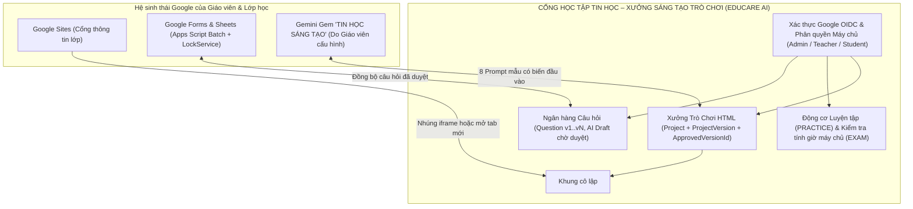

# TÀI LIỆU BÀN GIAO HỆ THỐNG: CỔNG HỌC TẬP TIN HỌC – XƯỞNG SÁNG TẠO TRÒ CHƠI (“TIN HỌC SÁNG TẠO”)

---

## 1. SO SÁNH KIẾN TRÚC & LỰA CHỌN PHƯƠNG ÁN CHÍNH (MỤC 2)

### 1.1. Bảng so sánh hai phương án kiến trúc

| Tiêu chí kỹ thuật & Sư phạm | Phương án A: Thuần Google Workspace + Apps Script (Sites + Forms + Sheets + HtmlService) | Phương án B (ĐÃ CHỌN): Hệ thống Web App Thống nhất (EDUCARE AI Next.js + CSDL Quan hệ/Prisma) + Liên thông Google Workspace, Apps Script, Forms & Sites |
| :--- | :--- | :--- |
| **Xác thực & Phân quyền (RBAC)** | Phụ thuộc phiên tài khoản Google trong Web App Apps Script; khó tách quyền chi tiết khi học sinh dùng tài khoản cá nhân ngoài miền trường học. | Xác thực Google OAuth 2.0 / OIDC chuẩn ở máy chủ (`HttpOnly` cookie, CSRF), kiểm tra quyền 3 vai trò (`ADMIN`, `TEACHER`, `STUDENT`) tại mọi API route. |
| **Chế độ Kiểm tra tính giờ & Bảo mật đáp án** | Google Forms hỗ trợ khóa 1 lần làm cho tài khoản trong miền Workspace, nhưng không có đồng hồ đếm ngược máy chủ tự thu bài hay khôi phục tự động từng câu khi rớt mạng nếu không cài Add-on bên thứ ba. | Tách bạch hoàn toàn **Luyện tập (`PRACTICE`)** và **Kiểm tra (`EXAM`)**: tính giờ trên máy chủ (`expiresAt`), tự động lưu tạm từng câu (`AUTOSAVE_ANSWERS`), chống nộp trùng (`idempotencyKey`), tuyệt đối không gửi `correctAnswer` về trình duyệt khi đang thi. |
| **Cô lập bảo mật Trò chơi HTML học sinh (Sandbox)** | `HtmlService` của Apps Script bọc trong `Google Caja / iframe` của Google nhưng chia sẻ ngữ cảnh thực thi phức tạp và bị giới hạn băng thông/quota 6 phút. | Cô lập nghiêm ngặt bằng `<iframe sandbox="allow-scripts">` (tuyệt đối **không** có `allow-same-origin`, `allow-top-navigation`, `allow-popups`, `allow-forms`) kết hợp ép `Content-Security-Policy` (`connect-src 'none'`). |
| **Xưởng sáng tạo, Duyệt phiên bản & Khôi phục (`v1` → `v2`)** | Lưu mã nguồn trên Google Sheets (giới hạn 50.000 ký tự/ô) + Drive; rất dễ xung đột khi nhiều học sinh nộp bài cùng lúc. | Quản lý vòng đời `DRAFT` → `PENDING_REVIEW` → `NEEDS_REVISION` / `APPROVED` → `HIDDEN`. Khi học sinh nộp `v2`, bản `v1` (`approvedVersionId`) vẫn hiển thị ổn định trên Thư viện cho tới khi Giáo viên duyệt `v2`. |
| **Tích hợp Google Sites, Classroom, Forms, Sheets** | Tích hợp sẵn trong Google Drive. | Cung cấp cả hai chiều: (1) Route nhúng độc lập `/embed/tro-choi/[slug]` cho Google Sites kèm nút mở tab dự phòng; (2) Gói Google Apps Script [`TinHocSangTao_Forms_Sheets.gs`](file:///d:/Educare_AI/google-apps-script/TinHocSangTao_Forms_Sheets.gs) để sinh Google Forms và đồng bộ Google Sheets theo lô (`Batch`). |

### 1.2. Chi phí, Hạn mức (Quotas), Điều kiện Tài khoản & Thanh toán

1. **Google Workspace (Drive, Docs, Sheets, Forms, Sites, Classroom)**:
   - **Chi phí**: Miễn phí với gói **Google Workspace for Education Fundamentals** (nếu trường đã đăng ký tên miền giáo dục) hoặc tài khoản Google cá nhân trong hạn mức lưu trữ 15 GB/tài khoản.
   - **Hạn mức Google Apps Script**:
     - Thời gian chạy tối đa: **6 phút / lần thực thi** (`Execution time limit`).
     - Số lượng Google Forms / Sheets API gọi trong ngày bị giới hạn theo loại tài khoản (Consumer vs Workspace for Education). Do đó tệp [`TinHocSangTao_Forms_Sheets.gs`](file:///d:/Educare_AI/google-apps-script/TinHocSangTao_Forms_Sheets.gs) bắt buộc dùng `getValues()` / `setValues()` theo lô và `LockService`.
2. **Google Gemini & Gemini Gems**:
   - **Điều kiện tài khoản & Độ tuổi**: Học sinh dưới 18 tuổi hoặc sử dụng tài khoản trường học có thể bị Quản trị viên Google Workspace tắt quyền truy cập Gemini hoặc không mở được liên kết Gem chia sẻ công khai.
   - **Giải pháp đã triển khai**: Hệ thống **không giả định mọi học sinh đều mở được Gem**. Trang [`/hoc-sinh/sang-tao-cung-ai`](file:///d:/Educare_AI/src/app/hoc-sinh/sang-tao-cung-ai/page.tsx) tích hợp sẵn **Bộ 8 Prompt điền biến trực tiếp trên web** và **2 mẫu khung HTML chuẩn trong Xưởng Trò Chơi** để học sinh làm việc ngay cả khi không truy cập được Gemini.
   - **Gemini API (Phía máy chủ)**: Nếu bật tính năng gợi ý câu hỏi nháp bằng API (`GEMINI_API_KEY`), sử dụng tầng miễn phí (Free Tier có giới hạn RPM/RPD) hoặc bật thanh toán (Pay-as-you-go trên Google AI Studio / Vertex AI) nếu lưu lượng toàn trường lớn.
3. **Cơ sở dữ liệu & Máy chủ Web App (Firebase / Cloud / Self-hosted)**:
   - Bản thử nghiệm cho 1 lớp (`Lớp 7A1`) chạy trực tiếp với cơ sở dữ liệu Prisma SQLite nội bộ (0 đồng chi phí hạ tầng đám mây).
   - Khi mở rộng lên nhiều khối lớp trên đám mây (Firebase / Google Cloud Run / PostgreSQL), phần vượt hạn mức miễn phí (Spark Plan) sẽ cần bật thanh toán (Blaze Plan theo mức tiêu thụ thực tế).

---

## 2. SƠ ĐỒ KIẾN TRÚC & CƠ SỞ DỮ LIỆU ĐÃ TRIỂN KHAI (MỤC 3 & 4)

### Danh sách 10 thực thể CSDL mới trong [`prisma/schema.prisma`](file:///d:/Educare_AI/prisma/schema.prisma#L503-L718):
1. [`Question`](file:///d:/Educare_AI/prisma/schema.prisma#L503-L532): Mã ổn định `code`, khối, chủ đề, bài học, mục tiêu cần đạt, mức độ nhận thức (`REMEMBER`, `UNDERSTAND`, `APPLY`, `HIGH_APPLY`), nguồn SGK & trang, `version`, `isAiDraft`, `isDemoData`.
2. [`Assessment`](file:///d:/Educare_AI/prisma/schema.prisma#L534-L560): Phân biệt `mode: "PRACTICE"` và `mode: "EXAM"`, `timeLimitMinutes`, `maxAttempts`, `revealAnswersMode`.
3. [`AssessmentItem`](file:///d:/Educare_AI/prisma/schema.prisma#L562-L580): Chốt cứng `questionVersion`, `snapshotQuestionText`, `snapshotOptionsJson`, `snapshotCorrectAnswer`, `snapshotExplanation` tại thời điểm phát hành đề.
4. [`Attempt`](file:///d:/Educare_AI/prisma/schema.prisma#L582-L605): Lưu `startedAt`, `expiresAt` (kiểm soát ở máy chủ), `idempotencyKey` (chống nộp trùng), `totalScore` (chấm ở máy chủ).
5. [`Answer`](file:///d:/Educare_AI/prisma/schema.prisma#L607-L619): Lưu câu trả lời tự động (`AUTOSAVE_ANSWERS`) giúp khôi phục ngay khi học sinh tải lại trang hoặc rớt mạng tạm thời.
6. [`Project`](file:///d:/Educare_AI/prisma/schema.prisma#L621-L651): Sản phẩm trò chơi HTML với `approvedVersionId` tách biệt khỏi bản nháp mới.
7. [`ProjectVersion`](file:///d:/Educare_AI/prisma/schema.prisma#L653-L670): Lưu mã nguồn HTML một tệp, báo cáo quét tĩnh `staticScanJson` và trạng thái duyệt từng phiên bản.
8. [`Comment`](file:///d:/Educare_AI/prisma/schema.prisma#L672-L685): Bình luận văn bản thuần an toàn (đã loại bỏ thẻ HTML, không hỗ trợ nhắn tin riêng giữa học sinh).
9. [`Report`](file:///d:/Educare_AI/prisma/schema.prisma#L687-L703): Báo cáo lỗi kiến thức / kỹ thuật / nội dung không phù hợp.
10. [`ModerationLog`](file:///d:/Educare_AI/prisma/schema.prisma#L705-L718): Nhật ký kiểm duyệt câu hỏi, trò chơi, phiên bản và thao tác xóa dữ liệu mẫu.

---

## 3. HƯỚNG DẪN NHÚNG TRÒ CHƠI LÊN GOOGLE SITES (MỤC 8)

Khi Giáo viên muốn đưa một trò chơi đã duyệt lên trang **Google Sites** của lớp:

1. **Cách 1 – Nhúng trực tiếp bằng URL (Embed by URL)**:
   - Trong trình biên tập Google Sites, chọn **Nhúng (Embed)** → **Bằng URL (By URL)**.
   - Dán đường dẫn:
     - Trò chơi mẫu 1 (Quiz 10 câu): `http://localhost:3000/embed/tro-choi/dau-truong-tin-hoc-7-quiz-10` (hoặc tên miền triển khai thực tế).
     - Trò chơi mẫu 2 (Mô phỏng 3 nhiệm vụ): `http://localhost:3000/embed/tro-choi/xuong-mo-phong-thuat-toan-tim-kiem-sap-xep`.
2. **Cách 2 – Nút mở cửa sổ cách ly độc lập (Phương án dự phòng bắt buộc khi Google Sites chặn iframe lồng nhau trên màn hình hẹp)**:
   - Ngay trên đầu trang `/embed/tro-choi/[slug]` và trong khung `SandboxedHtmlGamePlayer` đều có nút **"Mở trong tab mới (Dự phòng Google Sites)"** để học sinh mở trò chơi toàn màn hình trong một tab trình duyệt độc lập nhưng vẫn nằm trong `<iframe sandbox="allow-scripts">`.

---

## 4. HƯỚNG DẪN SAO LƯU, KHÔI PHỤC, BẢO TRÌ & XÓA DỮ LIỆU MẪU (MỤC 13)

1. **Xóa riêng dữ liệu mẫu thử nghiệm (`isDemoData = true`)**:
   - Giáo viên truy cập [`/giao-vien/duyet-tro-choi`](file:///d:/Educare_AI/src/app/giao-vien/duyet-tro-choi/page.tsx) và nhấn nút **"Xóa riêng dữ liệu mẫu thử nghiệm"**.
   - Hệ thống sẽ chỉ xóa các câu hỏi, đề kiểm tra, trò chơi và bình luận có gắn nhãn `[DỮ LIỆU MẪU]` (`isDemoData: true`), giữ nguyên 100% dữ liệu thật của trường.
   - Nếu muốn nạp lại bộ dữ liệu mẫu Lớp 7A1 để tập huấn, nhấn nút **"Khôi phục dữ liệu mẫu Lớp 7A1"**.
2. **Sao lưu & Khôi phục Cơ sở dữ liệu**:
   - Sao lưu tệp cơ sở dữ liệu `prisma/dev.db` định kỳ hoặc xuất Ngân hàng câu hỏi sang Google Sheets qua [`google-apps-script/TinHocSangTao_Forms_Sheets.gs`](file:///d:/Educare_AI/google-apps-script/TinHocSangTao_Forms_Sheets.gs).
   - Khi cần khôi phục phiên bản trò chơi HTML bị lỗi sau khi cập nhật, Giáo viên chọn phiên bản `v1 (APPROVED)` trong [`/giao-vien/duyet-tro-choi`](file:///d:/Educare_AI/src/app/giao-vien/duyet-tro-choi/page.tsx) và nhấn **"Khôi phục hiển thị về v1"**.

